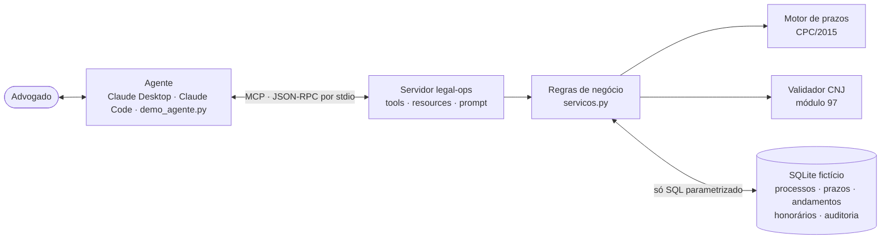

# mcp-legal-ops

**Um servidor MCP que deixa qualquer agente de IA operar o dia a dia de um escritório de advocacia — com prazos em dias úteis contados do jeito do CPC e nenhuma escrita sem confirmação humana.**


> Todos os dados são **fictícios**: escritório, advogados, clientes e números de processo são gerados por script.

## O problema

Escritório de advocacia vive de prazo: perder um é o pior erro possível, e o controle costuma estar espalhado entre sistema jurídico, planilha e e-mail.
Agentes de IA já conseguem ajudar, mas cada integração vira código sob medida para um modelo e um sistema.
O **Model Context Protocol (MCP)** resolve a ponta da integração: o sistema expõe ferramentas uma vez e qualquer cliente MCP (Claude Desktop, Claude Code, outros agentes) passa a usá-las.

## O que tem aqui

| Tipo MCP | Nome | O que faz |
|---|---|---|
| Tool | `buscar_processo` | Por número CNJ (com ou sem máscara) ou nome do cliente/parte; traz últimos andamentos e prazos abertos |
| Tool | `prazos_vencendo(dias)` | Fila de prazos abertos até hoje + N dias, com dias úteis restantes e situação (ATRASADO, VENCE HOJE, a vencer) |
| Tool | `calcular_prazo(data_intimacao, dias_uteis)` | Vencimento em dias úteis com memória de cálculo (períodos pulados e motivo) |
| Tool | `registrar_andamento` | **Escrita.** Valida tudo, devolve prévia; só grava com `confirmar=true`; pode dar baixa num prazo |
| Tool | `kpis_escritorio` | Prazos cumpridos x perdidos, volume por área, carga por advogado, honorários |
| Tool | `validar_numero_cnj` | Confere o dígito verificador (módulo 97) e decodifica segmento, tribunal e origem |
| Resource | `manual://regimento-interno`, `manual://controle-de-prazos`, `manual://glossario` | Base de conhecimento interna (fictícia) |
| Resource template | `escritorio://feriados/{ano}` | Feriados que o motor de prazos considera naquele ano |
| Prompt | `relatorio_semanal` | Roteiro para o agente montar a pauta da reunião de segunda-feira |



## Como rodar (2 comandos)

```bash
python -m venv .venv && .venv/bin/pip install -e ".[dev,agente]"
.venv/bin/python demo_agente.py --modo offline
```

No Windows troque `.venv/bin/` por `.venv\Scripts\`. O modo offline não precisa de chave nem de rede: o servidor sobe por stdio, a base fictícia é gerada e um roteiro determinístico exercita todas as tools, inclusive a escrita com confirmação.

Outros modos (chaves só por variável de ambiente; veja `.env.example`):

```bash
python demo_agente.py --modo claude      # ANTHROPIC_API_KEY; modelo padrão claude-sonnet-5-5
python demo_agente.py --modo gemini      # GEMINI_API_KEY; modelo padrão gemini-3.5-flash
python demo_agente.py --modo claude --pergunta "O que vence esta semana para o Rafael?" --salvar docs/minha-conversa.md
```

Testes e lint: `pytest` e `ruff check .`

## Usar no Claude Desktop / Claude Code

O servidor cria e popula `data/escritorio.db` sozinho na primeira execução (ou use `LEGAL_OPS_DB`).

**Claude Desktop** — edite `claude_desktop_config.json` (Windows: `%APPDATA%\Claude\claude_desktop_config.json`; macOS: `~/Library/Application Support/Claude/claude_desktop_config.json`; Linux: `~/.config/Claude/claude_desktop_config.json`) e reinicie o app.

Windows:

```json
{
  "mcpServers": {
    "legal-ops": {
      "command": "C:\\caminho\\mcp-legal-ops\\.venv\\Scripts\\python.exe",
      "args": ["-m", "legal_ops.server"],
      "env": { "LEGAL_OPS_DB": "C:\\caminho\\mcp-legal-ops\\data\\escritorio.db" }
    }
  }
}
```

Linux/macOS:

```json
{
  "mcpServers": {
    "legal-ops": {
      "command": "/caminho/mcp-legal-ops/.venv/bin/python",
      "args": ["-m", "legal_ops.server"],
      "env": { "LEGAL_OPS_DB": "/caminho/mcp-legal-ops/data/escritorio.db" }
    }
  }
}
```

**Claude Code:**

```bash
# Linux/macOS
claude mcp add legal-ops -- /caminho/mcp-legal-ops/.venv/bin/python -m legal_ops.server
# Windows
claude mcp add legal-ops -- C:\caminho\mcp-legal-ops\.venv\Scripts\python.exe -m legal_ops.server
```

Depois é só perguntar: *"quais prazos vencem esta semana?"* ou usar o prompt `relatorio_semanal`.

## Transcrição real

Rodada de `python demo_agente.py --modo gemini` em 24/11/2026 (data de referência fixa da base de demo), com Gemini 3.5 Flash decidindo sozinho quais tools chamar. Resultados das tools encurtados com `…`; a íntegra está em [`docs/transcricao-gemini.md`](docs/transcricao-gemini.md). A transcrição do modo offline, que vai até a gravação confirmada e os KPIs, está em [`docs/transcricao-offline.md`](docs/transcricao-offline.md).

> **Usuário:** Sou a Helena Andrade. Quais prazos meus vencem nos próximos 7 dias? Para o mais urgente, traga o resumo do processo, confira o vencimento pela contagem de dias úteis e prepare a prévia do andamento de protocolo da peça (não grave nada ainda).

```text
→ prazos_vencendo({"dias": 7, "advogado": "Helena Andrade"})
  ← {"total": 2, "atrasados": 0, "prazos": [{"id": 33, "descricao": "Especificação de provas",
     "data_intimacao": "2026-11-14", "dias_uteis": 5, "data_vencimento": "2026-11-24", …
→ buscar_processo({"termo": "0305941-69.2025.8.13.0024"})
  ← {"encontrados": 1, "processos": [{"cliente": "Bruno Jardim Kowalski", "classe": "Procedimento do
     Juizado Especial Cível", "status": "ativo", …
→ calcular_prazo({"dias_uteis": 5, "data_intimacao": "2026-11-14"})
  ← {"dia_do_comeco": "2026-11-16", "inicio_contagem": "2026-11-17", "vencimento": "2026-11-24",
     "periodos_nao_uteis": [{"de": "2026-11-20", "ate": "2026-11-22", "motivos": ["feriado: Dia Nacional
     de Zumbi e da Consciência Negra", "sábado", "domingo"]}], …
→ registrar_andamento({"descricao": "Protocolo de petição de especificação de provas.", "confirmar": false,
     "numero_cnj": "0305941-69.2025.8.13.0024", "tipo": "peticao", "registrado_por": "Helena Andrade",
     "cumpre_prazo_id": 33})
  ← {"gravado": false, "confirmacao_necessaria": true, "mensagem": "Nada foi gravado. …", "previa": {…}}
```

> **Agente** (resposta condensada aqui; o texto integral, com o resumo do processo, está no arquivo):
> **[MAIS URGENTE] Especificação de provas** — processo `0305941-69.2025.8.13.0024`, vence **24/11/2026 (VENCE HOJE)**. Contrarrazões de apelação no `4480957-81.2023.8.19.0311` vencem em 27/11 (restam 3 dias úteis).
>
> Conferência: intimação em 14/11/2026 (sábado) → dia do começo 16/11 (segunda) → contagem a partir de 17/11; pulados 20/11 (Consciência Negra), 21 e 22/11 → **vencimento confirmado 24/11/2026**. *A contagem não inclui feriados locais/estaduais nem portarias de suspensão do tribunal.*
>
> Prévia do andamento (não gravado): petição em 24/11/2026, "Protocolo de petição de especificação de provas.", baixa do prazo 33. **Deseja que eu confirme e grave este andamento no sistema?**

Repare que o modelo parou na prévia e pediu confirmação: o protocolo de duas etapas está na descrição da tool, e o servidor recusaria a gravação de qualquer forma sem `confirmar=true`.

## Decisões

- **SDK oficial `mcp` 2.x.** A classe `FastMCP` da versão 1 virou `MCPServer` na 2; o estilo é o mesmo (decorators, schema gerado dos type hints). Transporte stdio, que é o que Claude Desktop e Claude Code usam para servidores locais.
- **Docstrings e `Field(description=...)` escritos para o modelo.** É o que ele lê para decidir quando chamar cada tool; dizem quando usar, o formato de entrada e o que volta. As tools também levam `ToolAnnotations` (`readOnlyHint` nas de leitura).
- **Regra de negócio separada do protocolo.** `servicos.py` não sabe o que é MCP; `server.py` só traduz. Erro previsto vira `ToolError` com mensagem legível para o modelo corrigir a chamada.
- **Guardrails de escrita em camadas:** (1) a única tool de escrita exige `confirmar=true` — sem isso só valida e devolve prévia; (2) validação completa antes de gravar (CNJ com DV, processo existente e não arquivado, advogado do escritório, data não futura nem anterior à distribuição, prazo do mesmo processo); (3) tabela `auditoria` com quem, quando, origem, alvo, resultado (`previa`, `recusado`, `gravado`) e detalhes; (4) nenhum SQL livre exposto, tudo parametrizado; (5) no `demo_agente.py`, um portão humano no cliente antes de qualquer `confirmar=true`.
- **Andamento não se edita nem apaga** pela API — correção é um novo andamento, como pede o regimento interno fictício.
- **Base determinística e relativa à data.** O seed usa semente fixa e datas relativas a "hoje" (ou `LEGAL_OPS_HOJE`), então sempre há prazos vencendo na semana e a demo é reproduzível.
- **Demo com loop de tool calling explícito**, sem framework: lista as tools via MCP, converte os schemas para o formato do Claude (Messages API) ou do Gemini (function declarations) e devolve cada resultado. No Claude, usa `effort: medium` e fallback de servidor em caso de recusa por política.

## Motor de prazos: o que faz e o que fica de fora

Faz (CPC/2015):
- conta só dias úteis (art. 219);
- exclui o dia do começo e inclui o do vencimento (art. 224);
- intimação em dia sem expediente: o dia do começo vai para o primeiro dia útil seguinte (art. 224, §1º);
- suspende de 20/12 a 20/01 (art. 220);
- feriados nacionais fixos e os móveis calculados pela Páscoa: Carnaval (segunda e terça), Sexta-feira Santa e Corpus Christi; inclui 20/11 (Consciência Negra, nacional desde a Lei 14.759/2023).

**Não** faz — e por isso a tool avisa o modelo para avisar o usuário:
- feriados estaduais e municipais (ex.: 9 de julho em SP, aniversário da cidade);
- suspensões decretadas pelo tribunal (indisponibilidade do PJe, portarias, greves);
- regra de quando a intimação eletrônica se considera feita (Lei 11.419/2006) — a tool recebe a data da intimação já definida;
- prazos em dobro (Fazenda Pública, Defensoria, litisconsortes com procuradores diferentes) e prazos em minutos/horas/meses;
- Carnaval e Corpus Christi não são feriados nacionais por lei; entram como dia sem expediente por decisão de projeto (a maioria dos tribunais fecha). Quarta-feira de Cinzas conta como dia útil.

## Limites

- Projeto de portfólio, não produto: não usar para controlar prazo real.
- Sem autenticação: stdio é local e de um usuário só. O "quem" da auditoria é o advogado informado e validado contra o cadastro, mais a origem (`LEGAL_OPS_CLIENTE`). Para transporte HTTP, o próximo passo seria OAuth (o SDK já suporta).
- SQLite de arquivo único; a camada de serviços é o ponto de troca para um sistema jurídico real via API.
- O demo com modelo real foi rodado com Gemini; o modo Claude segue o mesmo loop, mas não foi executado nesta versão por falta de chave no ambiente.

## Estrutura

```
src/legal_ops/
  server.py        tools, resources e prompt MCP
  servicos.py      regras de negócio e auditoria
  prazos.py        motor de prazos (CPC/2015)
  cnj.py           numeração única CNJ (módulo 97)
  seed.py          base fictícia determinística
  db.py            schema SQLite
  conhecimento/    manual e regimento (fictícios)
demo_agente.py     cliente MCP + loop de tool calling (offline, Claude, Gemini)
tests/             55 testes, incluindo integração por stdio
```

Licença MIT.
